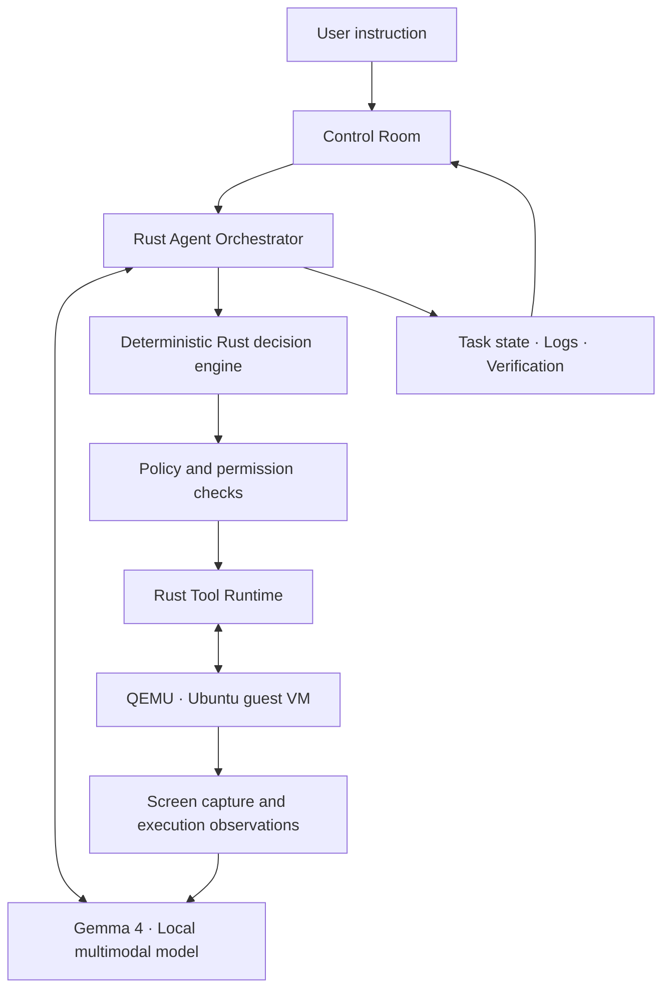

<!--
  RUSTED AI
  A Rust-native, local-first autonomous computer operator.
-->

<div align="center">

# RUSTED AI

### The local AI computer operator. Engineered in Rust.

**See the screen. Understand the task. Operate the machine. Verify the result.**

[](https://www.rust-lang.org/)
[](#design-principles)
[](#intelligence-layer)
[](#isolated-execution)

<br />

**RUSTED AI** is a Rust-native, local-first autonomous computer-operation platform.

It is designed to turn a multimodal language model into an agent that can perceive a desktop, reason about what needs to happen, use computer tools, and verify the outcome — within an execution environment controlled by the user.

<br />

[Project Vision](#-project-vision) ·
[Architecture](#-architecture) ·
[Design Principles](#-design-principles) ·
[Roadmap](#-development-status)

</div>

---

## ⚡ Project Vision

Most AI assistants stop at producing an answer.

**RUSTED AI aims to go further: it should be able to get work done on a computer.**

Give it a natural-language task:

> Organize my development workspace, inspect the project documentation, identify duplicate files, and prepare a report of the changes.

The intended agent loop is:

1. **Understand** the user's requested outcome.
2. **Plan** a sequence of steps to reach it.
3. **Perceive** the current computer state through screenshots and other observations.
4. **Select tools** appropriate to the next operation.
5. **Validate** the proposed operation against permissions and policy.
6. **Execute** inside an isolated Ubuntu virtual machine.
7. **Observe and recover** when the environment behaves unexpectedly.
8. **Verify** the outcome and report what actually happened.

The objective is not to generate a convincing description of completed work. It is to perform permitted actions, inspect their effects, and distinguish verified success from failure.

## 🧠 Architecture

RUSTED AI follows a **single-model, deterministic-execution architecture**.

One multimodal model handles high-level reasoning and visual understanding. Rust owns orchestration, tool execution, permissions, state management, and the boundary between model-generated requests and real computer actions.



### Intelligence Layer — One Gemma Model

**Planned model:** Gemma 4 12B QAT Uncensored.

The same multimodal model is intended to handle:

- Natural-language instruction understanding.
- Multi-step planning and reasoning.
- Screenshot interpretation and visual perception.
- Structured tool requests.
- Interpretation of execution results.
- Plan adjustment when observations differ from expectations.

The model is the reasoning and perception component. It is **not** the authority that grants itself permissions or directly controls the host.

> Model format, quantization, vision-projector compatibility, and GPU performance must be validated against the selected Rust inference runtime before the inference backend is considered final.

### Agent Orchestration — Rust

The orchestrator coordinates the task lifecycle:

- Task creation and state transitions.
- Planning and execution coordination.
- Tool registry and dispatch.
- Context and observation management.
- Timeouts, retries, and recovery.
- Completion and failure reporting.

### System One — Deterministic Rust

RUSTED AI does not introduce a second neural model for routine operational decisions.

Fast, bounded decisions belong in ordinary Rust code:

- Validate tool-call schemas and arguments.
- Check permissions and execution policy.
- Classify operation risk.
- Enforce timeouts and resource limits.
- Route tool requests.
- Handle deterministic retry conditions.
- Maintain valid execution states.
- Require human approval where policy demands it.

**Gemma proposes. Rust validates and authorizes. The runtime executes.**

### Computer Tools — Rust

The intended tool surface includes:

| Tool | Intended Capability |
|---|---|
| Filesystem | Inspect, create, read, modify, move, and organize files |
| Shell | Run commands and capture exit status and output |
| Keyboard | Send key events to the guest environment |
| Mouse | Move, click, scroll, and interact with UI elements |
| Screen capture | Obtain visual observations of the guest desktop |
| Browser | Navigate and interact with web interfaces |
| Application control | Launch and manage applications in the guest |

Tools should use typed inputs and outputs. Tool results must be returned to the orchestrator as observations, not treated as proof of success without verification.

### Isolated Execution — QEMU and Ubuntu

The host and guest have different responsibilities:

- **Host Ubuntu:** Runs and supervises the RUSTED AI application.
- **Ubuntu guest VM:** Provides the agent's operational desktop and execution environment.
- **QEMU/QMP:** Provides VM lifecycle and supported input-control interfaces.
- **Guest communication:** Uses controlled channels such as SSH where appropriate.
- **Display observation:** Captures the guest screen for visual reasoning.

The VM is an execution boundary, not a claim of perfect security. Guest configuration, shared folders, networking, device passthrough, and host integration must be reviewed as part of the threat model.

Sensitive host resources should not be exposed to the guest by default.

### Control Room — Rust UI

The Control Room is the human supervision surface.

Its intended responsibilities include:

- Submit and manage tasks.
- Inspect the current task and plan.
- Observe agent activity and tool calls.
- View execution logs and screenshots.
- Approve or reject sensitive operations.
- Inspect failures, retries, and verification results.

The UI framework is not locked. A Rust-based UI implementation will be selected without moving application logic into JavaScript or TypeScript.

---

## 🔁 The Execution Loop

RUSTED AI is designed around a closed feedback loop:

```text
      ┌──────────────────────────┐
      │       User task          │
      └────────────┬─────────────┘
                   ▼
      ┌──────────────────────────┐
      │    Gemma: reason/plan    │
      └────────────┬─────────────┘
                   ▼
      ┌──────────────────────────┐
      │ Rust: validate/authorize │
      └────────────┬─────────────┘
                   ▼
      ┌──────────────────────────┐
      │ Rust tools: act in VM    │
      └────────────┬─────────────┘
                   ▼
      ┌──────────────────────────┐
      │ Observe the new VM state │
      └────────────┬─────────────┘
                   ▼
      ┌──────────────────────────┐
      │ Gemma: evaluate outcome  │
      └────────────┬─────────────┘
                   │
           Continue or finish
                   │
                   └───────↺
```

A click is not a successful task. A command being launched is not proof that its intended effect occurred.

The agent must inspect the resulting state and verify the requested outcome.

---

## 🛡️ Design Principles

| Principle | Engineering Interpretation |
|---|---|
| **Rust-first** | All first-party application logic is implemented in Rust. |
| **Local-first** | Inference and task execution are intended to run under user control, without a required cloud agent service. |
| **One model** | A single multimodal model handles reasoning and visual perception. |
| **Deterministic control** | Permissions, validation, routing, and state transitions are enforced by Rust. |
| **Isolation by default** | Computer operations target a dedicated guest VM, not the host desktop. |
| **Least privilege** | Tools receive only the capabilities and resources required for a task. |
| **Human oversight** | Sensitive or destructive actions can be gated on explicit approval. |
| **Observable execution** | Plans, tool calls, outputs, errors, and verification evidence are inspectable. |
| **Honest outcomes** | The system reports partial completion and failure instead of inventing success. |

### Security Boundary

A model-generated tool call is untrusted input. It must never become executable authority by itself.

Every action should pass through:

1. Schema and argument validation.
2. Capability and permission checks.
3. Risk policy evaluation.
4. Approval requirements, when applicable.
5. Execution limits and controlled dispatch.
6. Result capture and verification.

An uncensored model is not inherently more capable, reliable, or safe.

Safety comes from the runtime's enforcement, isolation, and operational design — not from the model's label.

---

## 🦀 Technology Direction

| Layer | Intended Technology |
|---|---|
| Application language | **Rust** |
| Async runtime | Tokio |
| Backend/API | Axum |
| Serialization | Serde |
| Error handling | thiserror / anyhow |
| Logging and tracing | tracing |
| Persistence | SQLite with SQLx |
| Local model | Gemma 4 12B QAT Uncensored |
| Inference integration | Rust-native runtime; compatibility validation pending |
| Virtualization | QEMU |
| Guest OS | Ubuntu Linux |
| VM management | QMP |
| Guest communication | SSH / controlled guest channels |
| GUI input | Rust-controlled keyboard and mouse events |
| Browser control | Rust-based browser integration |
| User interface | Rust-based UI; framework to be selected |

**Language constraint:** First-party application code — orchestration, policy engine, tool runtime, backend, persistence integration, and UI — is to be written in Rust.

Python, JavaScript, TypeScript, Node.js, and external agent frameworks are outside the application architecture.

QEMU, Ubuntu, model weights, and other external infrastructure are dependencies, not code we claim to have rewritten in Rust.

---

## 🧭 Development Status

RUSTED AI is an actively designed engineering project.

The architecture below describes the intended direction, not a declaration that every subsystem is already implemented.

| Area | Direction | Status |
|---|---|---|
| Product architecture | Single-model, Rust-native design | Defined |
| Rust orchestration | Task lifecycle and coordination | Planned |
| Inference backend | Gemma 4 through a Rust runtime | Compatibility validation required |
| Vision pipeline | Screenshot input to the same model | Planned |
| Deterministic decision engine | Policy, validation, and state control | Planned |
| Tool runtime | Shell, filesystem, GUI, browser | Planned |
| VM execution | QEMU-managed Ubuntu guest | Planned |
| Control Room | Rust-based supervision UI | Planned |
| Observability | Logs, observations, verification | Planned |

### Suggested Implementation Sequence

- [ ] Establish the Rust workspace and module boundaries.
- [ ] Validate Gemma 4 text and vision inference using the selected Rust runtime.
- [ ] Build the typed agent protocol and deterministic state machine.
- [ ] Implement the policy and permission engine.
- [ ] Integrate QEMU lifecycle management and guest communication.
- [ ] Add screenshot capture and visual feedback.
- [ ] Implement keyboard, mouse, shell, and filesystem tools.
- [ ] Add execution verification, recovery, and audit logs.
- [ ] Build the Control Room.
- [ ] Validate isolation, failure handling, and end-to-end workflows.

---

## 💻 Development Constraints

These are project-level constraints, not optional preferences:

- First-party application code must be Rust.
- No Ollama dependency or Ollama API integration.
- No Python or Node.js agent backend.
- No CrewAI, LangChain, or other external agent orchestration framework.
- One neural model for reasoning and visual perception.
- No direct model authority over host execution.
- VM operations must be mediated by the Rust runtime.
- Unverified actions must not be reported as completed.

---

## 🎯 Long-Term Objective

The intended end state is a self-hosted computer operator that can:

- Operate an Ubuntu desktop inside a VM.
- Use terminal and graphical applications.
- Create, inspect, modify, and organize files.
- Work with local development projects.
- Navigate and interact with browser interfaces.
- Complete multi-step digital workflows.
- Recover from unexpected execution states.
- Retain task context and provide verifiable reports.

RUSTED AI aims to make computer-use autonomy inspectable and controllable:

**The model supplies intelligence. Rust supplies operational discipline. The isolated guest supplies the workspace.**

---

<div align="center">

## RUSTED AI

**Intelligence stays local. Execution stays controlled. The machine gets things done.**

<sub>Designed with Rust · Built for local autonomy · Supervised by the user</sub>

</div>
