# RUSTED AI — Agent Lifecycle and State Machine

**Purpose:** Define the only valid task lifecycle.  
**Owner:** `rusted-agent` crate

## 1. Lifecycle principle

A task is a controlled state machine, not an unbounded model/tool loop. Every transition is validated in Rust. The model cannot change the task state directly.

```mermaid
stateDiagram-v2
    [*] --> Queued
    Queued --> Understanding
    Understanding --> Planning
    Planning --> Validating
    Validating --> AwaitingApproval: approval required
    Validating --> Executing: authorized
    Validating --> Blocked: denied or missing capability
    AwaitingApproval --> Executing: approved
    AwaitingApproval --> Cancelled: rejected/cancelled
    AwaitingApproval --> TimedOut: approval deadline reached
    Executing --> Observing
    Executing --> Recovering: retryable failure
    Executing --> Failed: terminal failure
    Observing --> Verifying
    Verifying --> Planning: objective not complete; more steps
    Verifying --> Completed: all acceptance conditions met
    Verifying --> PartiallyCompleted: some conditions met; cannot continue
    Verifying --> Failed: objective failed
    Recovering --> Planning: bounded recovery succeeded
    Recovering --> Failed: retries exhausted
    Queued --> Cancelled
    Understanding --> Cancelled
    Planning --> Cancelled
    Completed --> [*]
    PartiallyCompleted --> [*]
    Failed --> [*]
    Blocked --> [*]
    Cancelled --> [*]
    TimedOut --> [*]
```

## 2. State definitions

| State | Meaning | Allowed next states |
|---|---|---|
| `Queued` | Task accepted and waiting for an execution slot. | Understanding, Cancelled |
| `Understanding` | Interpret goal, constraints, and completion conditions. | Planning, Failed, Cancelled |
| `Planning` | Produce or revise a bounded plan. | Validating, Failed, Cancelled |
| `Validating` | Validate step schema, capabilities, policy, and resource limits. | Executing, AwaitingApproval, Blocked, Failed, Cancelled |
| `AwaitingApproval` | A human decision is required before the protected action. | Executing, Cancelled, TimedOut |
| `Executing` | One authorized tool action is running. | Observing, Recovering, Failed, Cancelled |
| `Observing` | Collect tool result and current guest state. | Verifying, Failed |
| `Verifying` | Compare observed state with the step/task completion conditions. | Planning, Completed, PartiallyCompleted, Failed |
| `Recovering` | Perform a bounded, policy-approved recovery action. | Planning, Failed |
| `Completed` | All task acceptance conditions are evidenced. | Terminal |
| `PartiallyCompleted` | Some work succeeded; remaining work is impossible, denied, or abandoned. | Terminal |
| `Blocked` | Policy or missing capability prevents safe continuation. | Terminal; resubmission creates a new task |
| `Failed` | Task cannot proceed due to an unrecoverable error. | Terminal |
| `Cancelled` | User or shutdown cancelled the task. | Terminal |
| `TimedOut` | Required approval was not received before its deadline. | Terminal |

Terminal states are immutable. Resuming a terminal task creates a new task linked to the prior task ID; it does not rewrite history.

## 3. Plan and step contract

A plan must include:

- Stable task and plan IDs.
- Ordered steps with stable step IDs.
- Step objective and expected result.
- Tool name and typed arguments, where applicable.
- Required capabilities.
- Risk tier and approval requirement.
- Deadline and retry policy.
- Observable completion condition.
- Dependencies on preceding steps.

The model may propose a plan. Rust validates size limits, references, tool availability, permissions, and step dependencies before execution.

## 4. Execution loop

For each step:

1. Validate the step schema and dependencies.
2. Derive required capability and risk tier from the tool and arguments in Rust.
3. Ask the policy engine to authorize the step.
4. If approval is required, pause in `AwaitingApproval` and record the request.
5. Dispatch only an authorized typed request.
6. Enforce deadline, output-size, and resource limits.
7. Record the structured tool result.
8. Capture a new observation when the action can change guest state.
9. Evaluate the completion condition.
10. Continue, recover, or terminate according to deterministic rules.

## 5. Retry and recovery rules

- Retry only errors explicitly classified as transient and only when the action is idempotent.
- Maximum automatic retry count is **2 per step**, with bounded backoff. This value is a fixed initial policy, not model-controlled.
- Never automatically retry deletion, package installation, upload, message sending, account changes, or other non-idempotent/external-side-effect operations.
- A retry must revalidate current state and permissions.
- If an action may have succeeded but the result is uncertain, observe first; do not blindly repeat.
- Recovery must not escalate permissions or invent new tools.
- Exhausted recovery transitions to `Failed` or `PartiallyCompleted` with evidence.

## 6. Timeouts and cancellation

- Every task, model call, tool call, and approval request has an explicit deadline.
- User cancellation is propagated to model generation and tools where supported.
- A task cancellation does not guarantee an external side effect has been reversed. Record the last known state and any uncertain operation.
- On application shutdown, persist state before stopping workers. In-flight external actions are marked interrupted/unknown, not successful.

## 7. Verification semantics

Tool success and task success are different:

- **Tool success:** the adapter completed its operation according to its own contract.
- **Step verified:** the observed system state satisfies the step's completion condition.
- **Task completed:** all required task acceptance conditions are verified.

When a step cannot be observed, mark it unverified and do not claim task completion. The model's statement that an action succeeded is not evidence by itself.

## 8. Required tests

- Every allowed transition succeeds.
- Every unspecified transition is rejected.
- Terminal states cannot transition.
- Approval timeout and rejection are terminal and audited.
- Cancellation propagates and preserves the last known state.
- Retry limit is enforced.
- Non-idempotent actions are never automatically retried.
- Uncertain outcomes trigger observation before any retry.
