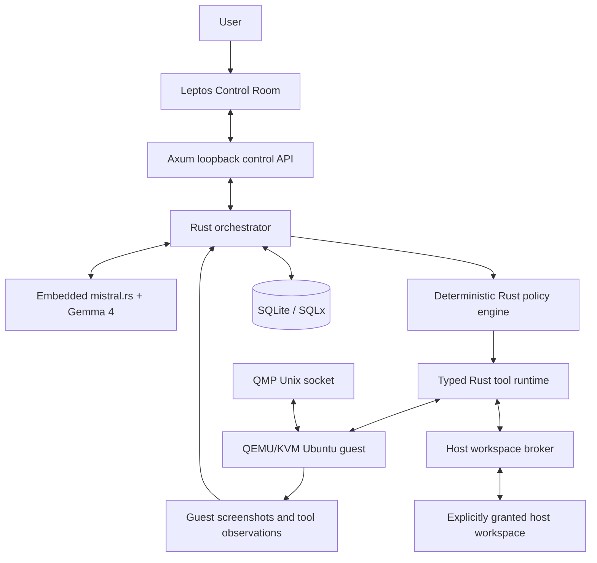

# RUSTED AI — System Architecture

**Status:** Accepted target architecture  
**Last reviewed:** 2026-11-24

## 1. Architecture summary

RUSTED AI is one local Rust application composed of cooperating Rust crates. It embeds one multimodal model through the mistral.rs Rust SDK, owns a deterministic policy engine, and operates a QEMU-managed Ubuntu guest. The Control Room is served locally by Axum with a Leptos UI.

There is no separate cloud agent, no Ollama process, and no second neural decision model.

## 2. Fixed implementation stack

| Concern | Decision |
|---|---|
| Language | Rust for all first-party application logic |
| Async | Tokio |
| Local Control Room API | Axum, bound to loopback only |
| UI | Leptos, written in Rust and compiled for the browser |
| Inference | Embedded mistral.rs Rust SDK |
| Model | Gemma 4 12B QAT Uncensored + matching vision projector |
| Serialization | Serde |
| Persistence | SQLite via SQLx |
| Diagnostics | tracing |
| Domain errors | thiserror; anyhow only at application boundaries |
| Virtualization | QEMU/KVM |
| VM control | QMP over Unix-domain socket |
| Guest operations | Authenticated SSH/guest channel over private management network |

See ADRs for rationale and constraints. Versions are pinned in Cargo manifests and `Cargo.lock` when implementation begins.

## 3. Process topology

The initial product runs as one supervised host application process with asynchronous internal tasks:

- Axum serves the local Control Room and control API.
- Tokio coordinates task execution, model calls, tool dispatch, and persistence.
- mistral.rs is loaded in-process through its Rust SDK; it is not an independent inference server.
- The VM manager controls the guest through a local QMP Unix socket.
- Guest commands and workspace transfers use an authenticated private management channel.
- SQLite stores task metadata, state transitions, approval records, and audit events.

Long-running inference and VM operations must not block the Axum request executor. Use bounded channels and explicit cancellation/deadline propagation.

## 4. Cargo workspace boundaries

The initial workspace uses these crates. Names may gain internal submodules, but responsibilities must not be merged casually.

| Crate | Owns | Must not own |
|---|---|---|
| `rusted-types` | Versioned IDs, plans, tool schemas, results, shared domain types. | OS calls, model loading, database access. |
| `rusted-inference` | mistral.rs adapter, model loading, prompt assembly, image input, generation configuration. | Tool authorization or direct tool execution. |
| `rusted-policy` | Capability checks, risk tiers, approvals, deterministic authorization. | Model inference, shell execution. |
| `rusted-agent` | Task lifecycle, planning loop, state machine, recovery coordination. | Raw QMP/SSH details or UI rendering. |
| `rusted-tools` | Typed tool registry and adapters for guest shell/filesystem/GUI/browser actions. | Host unrestricted filesystem or host shell. |
| `rusted-vm` | QEMU process configuration, QMP client, guest health and communication. | Model prompts, task planning. |
| `rusted-workspace` | Host workspace grants, snapshot staging, manifests, diff and approved copy-back. | Arbitrary host path access. |
| `rusted-storage` | SQLite schema, migrations, repositories, audit persistence. | Agent policy decisions. |
| `rusted-api` | Axum routes, request validation, loopback server, UI/API boundary. | Direct privileged OS execution. |
| `rusted-ui` | Leptos components and user interactions. | Inference/model loading, direct QMP/SSH. |
| `rusted-app` | Configuration, dependency wiring, startup/shutdown. | Domain logic that belongs in another crate. |

### Dependency direction

- `rusted-types` is the lowest-level shared contract crate.
- `rusted-policy` depends on shared types, not on tool implementations.
- `rusted-inference` returns typed model outputs; it cannot dispatch tools.
- `rusted-agent` coordinates inference, policy, tools, storage interfaces, and lifecycle.
- `rusted-tools` depends on guest/workspace interfaces and shared types.
- `rusted-api` and `rusted-ui` call application-facing interfaces only.
- `rusted-app` wires implementations together.

Avoid circular crate dependencies. Where an interface is needed across layers, define a narrow Rust trait in the owning domain crate.

## 5. Model-to-tool boundary

The model returns text and/or a structured tool proposal. The inference adapter parses the response into a versioned request type. The orchestrator sends the request to the policy engine. Only an authorized request may reach a registered tool adapter.

Free-form model text is never passed directly to `Command::new`, a shell, QMP, SSH, or a host filesystem API. Tool adapters accept typed arguments and construct their own bounded operations.

## 6. VM and host boundary

The host owns VM lifecycle and the workspace broker. The guest performs task actions. There is no live mount of the host home directory.

- QMP is accessible only through a local Unix socket owned by the host application.
- Guest management traffic uses a private network and authenticated keys.
- Guest user is unprivileged for ordinary tasks; elevation is denied by default.
- The host workspace broker stages only explicitly granted paths into a per-task guest workspace.
- Guest modifications return as a manifest/diff. Copy-back to the original host workspace requires the policy-defined approval path.
- Guest outbound network access is off by default and requires a task capability plus approval.
- No inbound guest port forwarding or bridged guest networking is permitted in the baseline design.

See `docs/security/THREAT_MODEL.md` and ADR-0004/0006.

## 7. Persistence and observability

SQLite is the source of truth for local task records and audit events. `tracing` provides operational diagnostics. Persist the following minimum records:

- Task ID, user objective, creation time, and terminal status.
- Plan version and state transitions.
- Tool request metadata, authorization result, start/end time, and structured result.
- Approval request, approver decision, and timestamp.
- Observation references and verification outcome.
- Runtime/model/VM configuration identifiers needed to reproduce a run.

Do not store credentials, API tokens, or raw secrets in prompts, logs, or audit payloads. Large screenshots may live in a controlled local artifact directory; SQLite stores references and hashes.

## 8. Configuration ownership

Configuration is loaded once at startup, validated, and exposed as immutable runtime configuration except for explicitly dynamic settings. Model paths, VM image paths, socket paths, network profiles, workspace grants, and resource limits must be explicit configuration values. Defaults must be secure and documented.

## 9. External dependencies

QEMU/KVM, Ubuntu, the Gemma model files, and the mistral.rs upstream crate are external components. They are not claimed to be rewritten in Rust. First-party application code and integration logic remain Rust.
